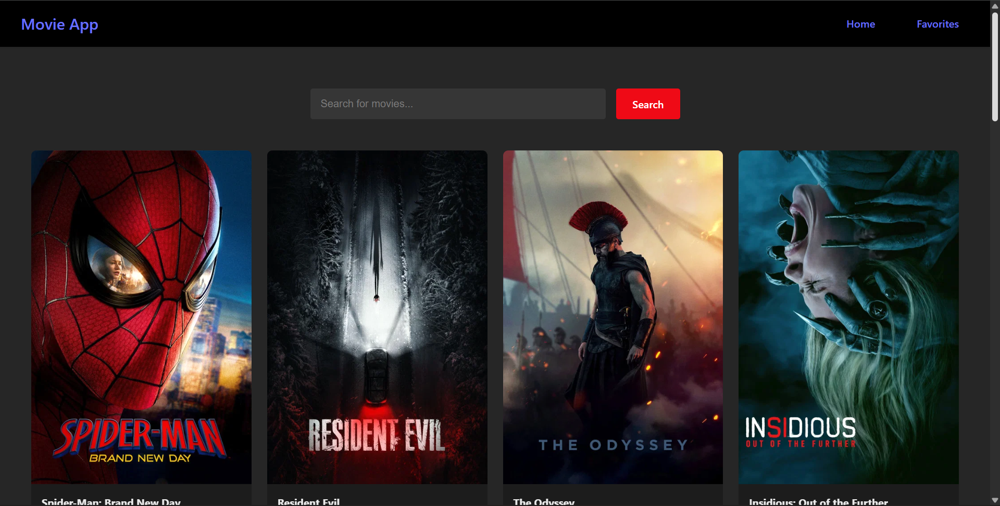

Movie Search App

A movie discovery app built with React that fetches popular movies and lets users search for movies using the TMDB API. Includes a favorites feature to save movies and revisit them later.

**[Live Demo](https://react-movie-app-opal-chi.vercel.app/)**

**[Repo](https://github.com/prateekbuilds/Movie-App)**

Features

🎬 Popular movies — displays popular movies fetched from the TMDB API.

🔍 Movie search — search for movies by title and view matching results.

❤️ Favorites — add movies to your favorites and remove them whenever you want.

⚛️ Context API — shares favorite movie state across components using React Context.

💾 Persistent favorites — uses localStorage to keep favorites saved after refreshing the page.

⏳ Loading and error handling — handles API requests and displays feedback when something goes wrong.

🧩 Reusable components — separates the UI into components for easier maintenance.

Tech Stack

React

JavaScript (ES6+)

Vite

CSS

React Hooks (useState, useEffect, useContext)

TMDB API

localStorage

Deployed on Vercel

Architecture

The app uses React components to separate the movie listing, movie cards, and other UI elements.

API functions are organized in a separate api.js file, which handles fetching popular movies and searching for movies through TMDB endpoints.

React state and hooks manage the application's behavior:

useState — manages movie data, search input, loading, and error states.

useEffect — triggers API requests when the relevant state changes.

useContext — provides shared access to favorites through a Movie Context.

localStorage — persists favorite movies across page refreshes.

The movie results are rendered dynamically using .map(), while search functionality retrieves matching results from the API.

API Integration

The app uses the TMDB API to fetch popular movies and search results.

The API logic is separated from the UI components to keep the code organized and easier to maintain.

The API key is configured through a Vite environment variable:

VITE_TMDB_API_KEY

For local development, create a .env file in the project root and add your TMDB API key. For deployment, configure the same variable in your hosting provider's environment settings.

Note: Vite environment variables prefixed with VITE_ are included in client-side code and are not secret. Do not use this approach for private server credentials.

Running Locally

Clone the repository:

git clone YOUR_GITHUB_REPOSITORY_URL

Navigate to the project directory:

cd YOUR_PROJECT_FOLDER

Install dependencies:

npm install

Create a .env file in the project root:

VITE_TMDB_API_KEY=your_tmdb_api_key

Start the development server:

npm run dev

Known Trade-offs

Client-side API key: The TMDB API key is used in browser requests, so it can be visible to users. A backend proxy would be needed to keep a credential private.

API dependency: Movie listings and search results depend on TMDB availability and a valid API key.

Search behavior: Search results depend on the query entered and the API response.

What I'd Add Next

Debounced search to reduce unnecessary API requests.

Improved loading states with skeleton cards.

Better handling of empty search results and API errors.

Movie details pages with ratings, descriptions, and release dates.

Unit and component tests.

TypeScript support for stronger type safety.